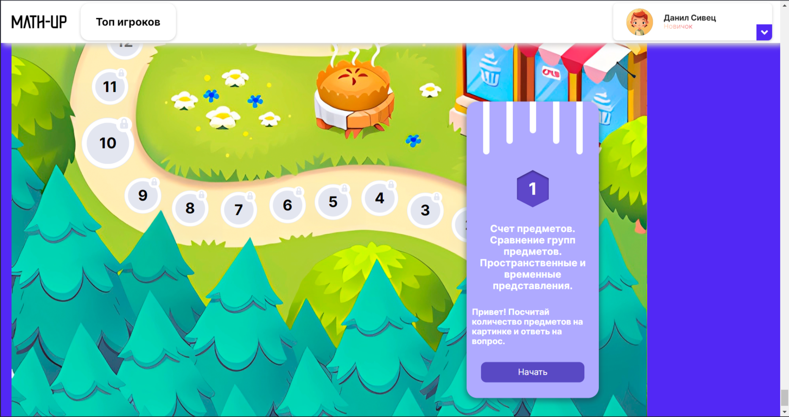

# MathUp!

MathUp! — веб-платформа для практики математики в 1–4 классах. Ученик может пройти кампанию по школьной программе или потренироваться на выбранных темах и посмотреть историю своих попыток.

Проект разработан для отборочного этапа II Всероссийского хакатона «Обучаюсь. Проектирую. Программирую. Будущее» по направлению «Программирование».

Данил Сивец предложил идею проекта, спроектировал архитектуру и координировал команду. Он участвовал в разработке бэкенда и реализовал генератор заданий.



## Что можно попробовать

- **Кампания.** 400 уровней от счёта предметов до умножения и деления на двузначные числа. Контрольные задания позволяют подтвердить знания за предыдущие классы. По мере прохождения сохраняется прогресс и обновляется рейтинг.
- **Тренажёр.** Шесть тем на каждый класс, режим «Микс» для практики по нескольким темам и история попыток с результатами.
- **Задания.** Ученик вводит ответ или выбирает вариант и сразу видит результат проверки. [Посмотреть пример задания](readme_imgs/img_3.png) · [Посмотреть историю попыток](readme_imgs/img.png).

В репозитории также есть [сборка для Android](apk/MathUp.apk).

## Как устроен проект

| Компонент | За что отвечает |
| --- | --- |
| [`main.py`](main.py), [`api/`](api/) | Приложение Flask, авторизация и маршруты кампании, тренажёра и профиля. |
| [`company/`](company/), [`generator/`](generator/) | Уровни кампании и генерация вариантов заданий. |
| [`data/`](data/) | Модели SQLAlchemy и подключение к SQLite. |
| [`templates/`](templates/), [`static/`](static/) | Шаблоны Jinja, интерфейс и сценарии прохождения заданий. |

## Локальный просмотр

Для запуска нужен Python 3.9. Выполните команды из корня репозитория в PowerShell.

```powershell
python -m venv .venv
.venv\Scripts\python.exe -m pip install -r requirements.txt
New-Item -ItemType Directory -Path history -Force | Out-Null
$env:key = & .venv\Scripts\python.exe -c "import secrets; print(secrets.token_hex(32))"
.venv\Scripts\python.exe main.py
```

Откройте [http://127.0.0.1:5000](http://127.0.0.1:5000). Переменная `key` задаёт ключ сеанса Flask. Для входа через Яндекс и восстановления пароля по почте нужно отдельно настроить внешние сервисы через переменные из [`data/config.py`](data/config.py).
